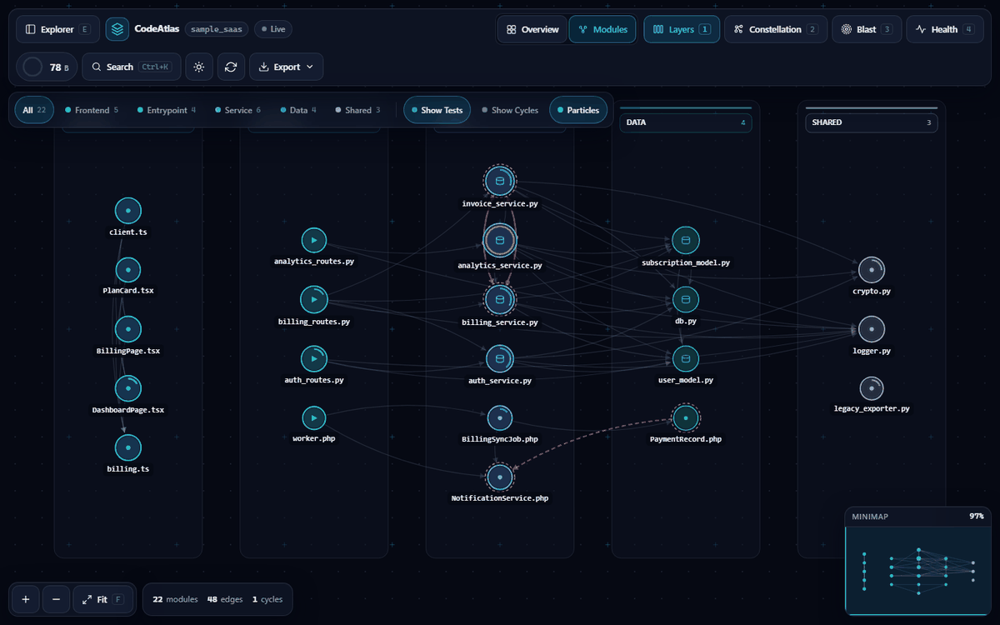
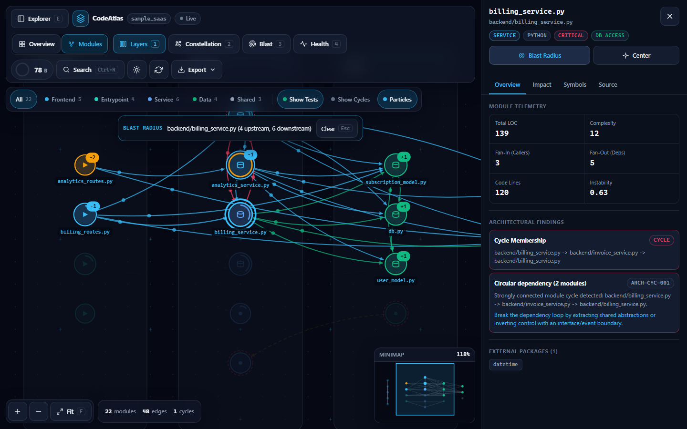
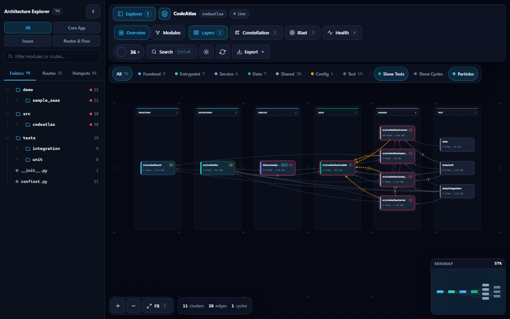
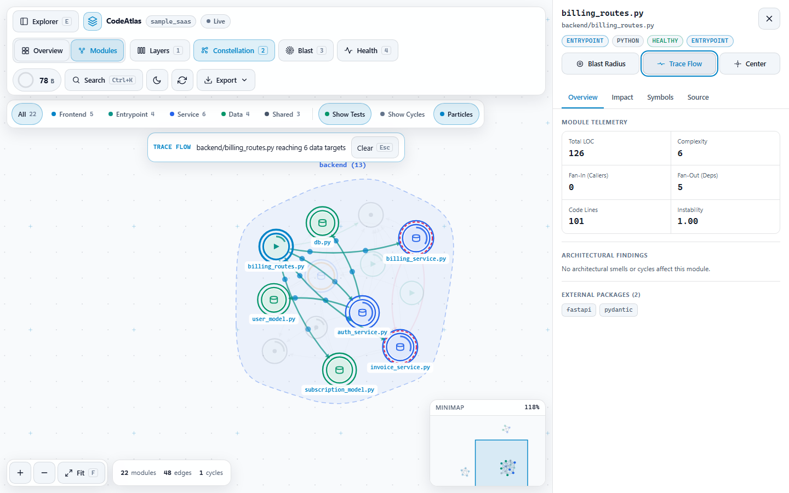
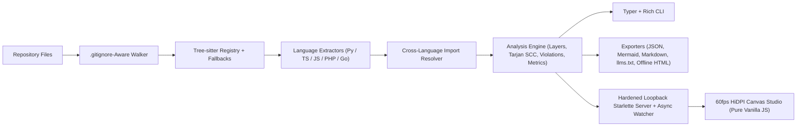

# CodeAtlas

**Static architecture mapper, cross-language dependency analyzer, and hardened localhost exploration studio.**

CodeAtlas parses polyglot codebases into deterministic module dependency graphs using Tree-sitter AST grammars, detects structural smells (circular dependencies, layer boundary violations, God modules, and dead-code candidates), generates token-budgeted `llms.txt` maps for AI coding assistants, and renders an interactive 60fps HiDPI Canvas Studio — with zero external CDNs and strict localhost security isolation.



---

## Visual Tour

### Obsidian Layers & Blast Radius Spotlight

*Obsidian Blueprint dark theme (`codeatlas demo`) in Layers view with `backend/billing_service.py` selected: Blast Radius Spotlight (`4 upstream, 6 downstream`), crimson cycle highlight (`ARCH-CYC-001`), minimap viewport sync, and the 4-tab Module Inspector.*

### Large-Repo Macro Cluster Overview & Architecture Explorer

*Macro Cluster Overview (`V`, auto-enabled when `nodes > 60`) grouping a 74-module scan into 11 Architectural Cluster Cards with aggregated cross-cluster edges, alongside the collapsible Left Architecture Explorer (`E`) with Quick Focus Presets (`All`, `Core App`, `Issues`, `Routes & Flow`) and `Folders`, `Routes`, and `Hotspots` tabs.*

### Architectural Paper Light Theme & Request-to-DB Trace Flow

*Architectural Paper light theme (`T`) in Constellation view with `backend/billing_routes.py` selected and Request-to-DB Trace Flow highlighting execution paths reaching 6 data targets.*

---

## Key Capabilities

- **Multi-Language Tree-sitter AST Extraction**: Parses **Python** (`.py`, `.pyw`), **TypeScript** (`.ts`, `.mts`, `.cts`, `.tsx`), **JavaScript** (`.js`, `.jsx`, `.mjs`, `.cjs`), **PHP** (`.php`, `.phtml`), and **Go** (`.go`) via modern `tree-sitter` (>= 0.23) grammars, with `stdlib-ast` (Python) and regex fallbacks emitting non-fatal `ParseWarning` entries on syntax errors.
- **Cross-Language Import & Route Resolution**:
  - **Python**: Relative and dotted imports across repository, `src/`, and subproject roots.
  - **TypeScript / JavaScript**: Relative specifiers plus JSONC-aware `tsconfig.json` / `jsconfig.json` `baseUrl` and `paths` aliases.
  - **PHP**: `composer.json` PSR-4 (`autoload` / `autoload-dev`) namespace resolution and relative includes.
  - **Go**: `go.mod` module prefix mapping and package-directory resolution.
  - **Framework Route Detection**: Extracts HTTP endpoints from FastAPI, Flask, Django, Express, Fastify, Next.js (App Router & Pages API), Laravel, Symfony, and Go (`net/http`, Gin, Echo, Fiber).
- **Deterministic Architectural Analysis**:
  - **7 Architectural Layers**: `frontend`, `entrypoint`, `service`, `data`, `shared`, `config`, `test` plus meaningful directory `Cluster` grouping.
  - **Iterative Tarjan SCC Cycles (`ARCH-CYC-001`)**: Recursion-free Strongly Connected Components detection with canonical shortest closed paths (`display_path`).
  - **Layer Boundary Rules (`ARCH-LAY-001`)**: Flags forbidden cross-layer imports with High/Medium severity and concrete remediation guidance.
  - **Coupling & Hotspot Metrics (`ARCH-GOD-001`, `ARCH-DEAD-001`)**: Computes `fan_in`, `fan_out`, `instability`, AST cyclomatic branch complexity, God Module hotspots, and unimported dead-code candidates.
  - **Transparent Health Scorecard**: Deterministic `0.0–100.0` score and letter grade (`A+` through `F`) with capped deduction penalties for cycles, layer violations, God modules, and dead files.
  - **Blast Radius & Request-to-Data Trace**: Cycle-safe BFS impact analysis (`compute_blast_radius`) and entrypoint-to-DB execution path tracing (`trace_request_to_db`).
- **60fps HiDPI Canvas Studio**:
  - **4 Spring-Animated Layouts**: **Layers** (`1`, 7-column swimlanes with barycenter crossing minimization), **Constellation** (`2`, seeded force-directed cluster hulls), **Blast** (`3`, concentric upstream/downstream impact rings), and **Health** (`4`, zone-isolated problem clusters scaled by LOC and complexity).
  - **Macro Cluster Overview (`V`)**: Auto-enabled when `nodes > 60`, grouping files by directory into `<= 24` Architectural Cluster Cards (merging smaller sibling folders when > 28 groups) with aggregated cross-cluster edges and drilldown breadcrumbs (`All Clusters > ...`, `+ Neighbors`).
  - **Left Architecture Explorer (`E`)**: Collapsible sidebar (auto-opened on wide viewports when `nodes > 60`) with live search, Quick Focus Presets (`All`, `Core App`, `Issues`, `Routes & Flow`), and `Folders`, `Routes`, and `Hotspots` tabs.
  - **Interactive Inspection**: Blast Radius Spotlight, Request-to-DB Trace Flow, animated flow particles, live SSE file-change ripples (`--watch`), minimap viewport sync, LOD label culling, Obsidian Blueprint & Architectural Paper themes (`T`), command palette (`Ctrl+K` or `/`), 4-tab Module Inspector (`Overview`, `Impact`, `Symbols`, `Source`), and 2x PNG snapshot export.
- **Token-Budgeted AI Context & Offline Exports**:
  - Exports deterministic **JSON**, **Mermaid** (`flowchart LR`), **Markdown** (`ARCHITECTURE.md`), **AI Context** (`llms.txt`), and **Standalone Offline HTML** bundles.

---

## System Architecture



---

## Quickstart

Requires **Python 3.11+**.

### 1. Install

```bash
pip install -e .
```

For development tooling (`pytest`, `ruff`, `mypy`, `httpx`):

```bash
pip install -e ".[dev]"
```

### 2. Explore the Bundled Demo

CodeAtlas ships with `demo/sample_saas/`, a 22-module polyglot SaaS sample spanning Python (FastAPI + SQLAlchemy), TypeScript/React, and PHP (Laravel worker) with realistic architectural smells planted for inspection:

```bash
codeatlas demo
```

Pass `--no-open` to print the Rich architectural summary and start the Studio without launching a browser, or `--port <PORT>` to pick a port (default: `8770`).

### 3. Scan a Repository from the CLI

```bash
# Render the Rich architectural dashboard in your terminal
codeatlas scan .

# Export a specific format to stdout or a file
codeatlas scan demo/sample_saas --format json --output architecture.json
```

### 4. Launch the Live Studio with File Watching

```bash
codeatlas serve . --watch
```

Available `serve` flags:

| Flag | Default | Description |
| --- | --- | --- |
| `--host` | `127.0.0.1` | Loopback interface to bind (`127.0.0.1`, `localhost`, or `::1`). Non-loopback hosts exit with code `2`. |
| `--port`, `-p` | `8770` | TCP port (`0` selects an ephemeral port; busy non-zero ports fall back to an ephemeral port). |
| `--watch` / `--no-watch` | `--no-watch` | Poll repository files (~0.8s interval) and push live `graph_updated` SSE events to the Studio. |
| `--no-open` | `false` | Do not automatically open the Studio URL in your default browser. |

You can also invoke CodeAtlas via `python -m codeatlas` or check the installed version with `codeatlas --version` (`-V`).

### 5. Export Reports & Offline Studio Bundles

```bash
# Standalone offline HTML studio (default theme: obsidian; also supports paper)
codeatlas export . --format html --output atlas.html --theme obsidian

# Markdown architectural report
codeatlas export . --format markdown --output ARCHITECTURE.md

# Mermaid dependency flowchart grouped by layer
codeatlas export . --format mermaid --output architecture.mmd

# Deterministic indented JSON graph + health report
codeatlas export . --format json --output architecture.json

# Token-budgeted AI context map
codeatlas export . --format llms --output llms.txt --max-tokens 8000
```

> **Note:** `codeatlas export` requires `--format` (`json`, `markdown`, `mermaid`, `llms`, or `html`) and `--output`; passing `console` to `export` exits with code `2`.

---

## Studio Controls & Shortcuts

| Shortcut | Action |
| --- | --- |
| `1` | Switch to **Layers** layout |
| `2` | Switch to **Constellation** layout |
| `3` | Switch to **Blast** radial impact layout |
| `4` | Switch to **Health** diagnostic layout |
| `V` | Toggle **Macro Cluster Overview** / **Modules** view |
| `E` | Toggle **Left Architecture Explorer** sidebar |
| `Ctrl+K` or `/` | Open command palette (modules, symbols, routes, smells) |
| `F` | Fit graph to viewport |
| `T` | Toggle **Obsidian Blueprint** (dark) / **Architectural Paper** (light) theme |
| `Esc` | Close palette / export menu / spotlight or trace banner / inspector |

---

## AI Context (`llms.txt`)

`codeatlas export <path> --format llms --output llms.txt --max-tokens 8000` generates a dense, deterministic architectural brief tailored for LLM context windows. It uses a conservative `len(text) / 4` token estimator to honor `--max-tokens` and prioritizes sections in order of diagnostic value:

1. Repository header, health score/grade, node/edge/smell counts, and language breakdown
2. Layer distribution (`## LAYERS`)
3. Structural smells (`## STRUCTURAL SMELLS` — `CYC`, `LAY`, `GOD`, `DEAD`)
4. API entrypoints and extracted routes (`## ENTRYPOINTS & ROUTES`)
5. Central hubs ranked by `fan_in + fan_out` with exported symbols and annotated `[CYC]`/`[VIOL]` edges (`## CENTRAL HUBS`)
6. Compact list of remaining modules (`## MODULES`) if budget remains

Example output on `demo/sample_saas` with `--max-tokens 600`:

```text
# CODEATLAS sample_saas
HEALTH: 78.0/100 (B) | NODES:22 EDGES:48 CYCLES:1 VIOL:1 HOTSPOTS:1 DEAD:1
LANGS: php:4, python:13, typescript:5
## LAYERS
frontend:5 | entrypoint:4 | service:6 | data:4 | shared:3
## STRUCTURAL SMELLS
CYC cycle-001: backend/billing_service.py -> backend/invoice_service.py -> backend/billing_service.py
LAY[high]: worker/src/Models/PaymentRecord.php -> worker/src/Services/NotificationService.php
GOD: backend/analytics_service.py (loc=360,cc=52,in=1,out=7)
DEAD: backend/legacy_exporter.py
## ENTRYPOINTS & ROUTES
GET /api/analytics/churn-risk -> backend/analytics_routes.py:churn_risk_endpoint [fastapi]
GET /api/analytics/cohorts -> backend/analytics_routes.py:cohorts_endpoint [fastapi]
GET /api/analytics/forecast -> backend/analytics_routes.py:forecast_endpoint [fastapi]
GET /api/analytics/overview -> backend/analytics_routes.py:overview_endpoint [fastapi]
POST /api/auth/login -> backend/auth_routes.py:login_endpoint [fastapi]
GET /api/auth/me -> backend/auth_routes.py:current_user_endpoint [fastapi]
POST /api/auth/password/rotate -> backend/auth_routes.py:rotate_password_endpoint [fastapi]
POST /api/auth/register -> backend/auth_routes.py:register_endpoint [fastapi]
GET /api/billing/invoices -> backend/billing_routes.py:list_invoices_endpoint [fastapi]
POST /api/billing/subscriptions -> backend/billing_routes.py:create_subscription_endpoint [fastapi]
POST /api/billing/subscriptions/{subscription_id}/cancel -> backend/billing_routes.py:cancel_subscription_endpoint [fastapi]
POST /api/billing/subscriptions/{subscription_id}/finalize -> backend/billing_routes.py:finalize_invoices_endpoint [fastapi]
POST /api/billing/subscriptions/{subscription_id}/upgrade -> backend/billing_routes.py:upgrade_subscription_endpoint [fastapi]
GET /worker/health -> worker/src/Routes/worker.php:closure [laravel]
POST /worker/sync -> worker/src/Routes/worker.php:closure [laravel]
## CENTRAL HUBS
HUB backend/billing_service.py [service/python] deg=8(in=3,out=5) loc=139 cc=12
  exports: get_plan_monthly_rate, calculate_prorated_charge, create_subscription, upgrade_subscription, cancel_subscription
  out: backend/db.py, backend/invoice_service.py[CYC], backend/logger.py, backend/subscription_model.py, backend/user_model.py
  in: backend/analytics_service.py, backend/billing_routes.py, backend/invoice_service.py[CYC]
```

---

## CI/CD Quality Gate

Use `codeatlas scan` with `--fail-on-cycles` and `--fail-on-violations` in CI to exit with status code `1` whenever circular dependencies or architectural layer violations are introduced:

```yaml
name: Architecture Gate

on:
  pull_request:

permissions:
  contents: read

jobs:
  architecture:
    runs-on: ubuntu-latest
    steps:
      - uses: actions/checkout@v4
      - uses: actions/setup-python@v5
        with:
          python-version: "3.12"
      - run: pip install .
      - name: Enforce cycle and layer boundary gates
        run: codeatlas scan . --fail-on-cycles --fail-on-violations
      - name: Generate architecture artifacts
        if: always()
        run: |
          codeatlas export . --format markdown --output ARCHITECTURE.md
          codeatlas export . --format llms --output llms.txt --max-tokens 8000
```

---

## Architectural Smells & Scoring Model

| Rule ID | Kind | Severity | Trigger / Boundary | Score Cap |
| --- | --- | --- | --- | --- |
| `ARCH-CYC-001` | `circular_dependency` | `high` | Strongly connected components with >= 2 modules (`8.0 + 2.0 * max(n - 2, 0)` per cycle) | `35.0` |
| `ARCH-LAY-001` | `layer_violation` | `high` / `medium` | **High** (`7.0` ea): `data->entrypoint`, `data->service`, `shared->service`, `shared->entrypoint`, `frontend->data`. **Medium** (`3.5` ea): `shared->data`, `service->entrypoint`. | `30.0` |
| `ARCH-GOD-001` | `god_module` | `medium` | Non-test/non-config module exceeding defaults: `loc >= 350`, `complexity >= 25`, `fan_out >= 10`, or `fan_in >= 12` (`5.0` ea) | `20.0` |
| `ARCH-DEAD-001` | `dead_code` | `low` | `fan_in == 0` and not an entrypoint, route holder, test, config, frontend page/root, or package marker (`2.0` ea) | `15.0` |

---

## Security Architecture

CodeAtlas treats every scanned repository as untrusted input and isolates its local web studio from browser-based cross-origin attacks:

- **Zero External CDNs**: All Studio CSS, Canvas rendering logic, layouts, and SVG icons are bundled locally (`src/codeatlas/ui/`). Standalone HTML exports embed every asset inline (`data:image/svg+xml` favicon + JSON bootstrap) with `connect-src 'none'`.
- **Strict Content Security Policy**:
  - Live Studio (`_SecurityMiddleware`): `default-src 'self'; script-src 'self'; style-src 'self'; img-src 'self' data: blob:; connect-src 'self'; frame-ancestors 'none'; base-uri 'none'`, plus `X-Content-Type-Options: nosniff`, `Referrer-Policy: no-referrer`, and `X-Frame-Options: DENY`.
  - Offline HTML Export: `default-src 'none'` with LF-normalized SHA-256 hashes for `<style>` and each `<script>` block, `connect-src 'none'`, `base-uri 'none'`, and escaped JSON bootstrap (`</`, `\u2028`, `\u2029`).
- **Zero DOM HTML Sinks**: Frontend scripts use `document.createElement` and `textContent` exclusively — zero `innerHTML`, `outerHTML`, `insertAdjacentHTML`, inline event handlers, or `setAttribute("style", ...)`.
- **Loopback-Only Binding & Socket Safety**: `validate_loopback_host` permits only `127.0.0.1`, `localhost`, and `::1`. On Windows (`os.name == "nt"`), sockets never enable `SO_REUSEADDR` and apply `SO_EXCLUSIVEADDRUSE` to prevent local port hijacking.
- **Host, Fetch & Origin Guards**: `_SecurityMiddleware` rejects mismatched `Host` headers (`403`), rejects `Sec-Fetch-Site: cross-site` across all `/api/*` endpoints (`403`), and validates loopback `Origin` headers on mutating routes (`POST`, `PUT`, `PATCH`, `DELETE`, `403`).
- **Hardened `/api/file` Source Preview**: Enforces strict `Path.is_relative_to(repo_root.resolve())` containment, rejects path traversal, NUL bytes, non-relative paths, and escaping symlinks (`403`), enforces a case-insensitive blocklist for sensitive files (`.env`, `.env.*`, `*.pem`, `*.key`, `*.p12`, `*.pfx`, `id_rsa*`, `id_ed25519*`, `*secret*`, `*credentials*`, `.git`, `.ssh`), caps previews at 256 KB (`413`), and rejects binary files containing NUL bytes in the first 8 KB (`415`).
- **Walker Containment**: Directory-scoped `.gitignore` matching, cross-platform inode/realpath loop deduplication, broken/escaping symlink skipping, binary sniffing, and deterministic `max_files=3000` / `max_file_bytes=1_048_576` bounds.

---

## Docker

Build and run a container scan against the bundled demo:

```bash
docker build -t codeatlas .
docker compose up --build
```

Run an export using the container image:

```bash
docker compose run --rm -v ./out:/out codeatlas export /workspace --format html --output /out/atlas.html
```

Because `codeatlas serve` strictly enforces loopback-only binding (`127.0.0.1`, `localhost`, or `::1`) and rejects `0.0.0.0`, Docker bridge port forwarding cannot reach an isolated container loopback address. Run `codeatlas demo` or `codeatlas serve` directly on your host loopback, or use `network_mode: host` on Linux hosts (see [docker-compose.yml](docker-compose.yml)).

---

## Development & Verification

```bash
ruff check src tests demo
ruff format --check src tests demo
mypy src
pytest -v
```

---

## License

CodeAtlas is released under the **MIT License**. See [LICENSE](LICENSE) for full details.
